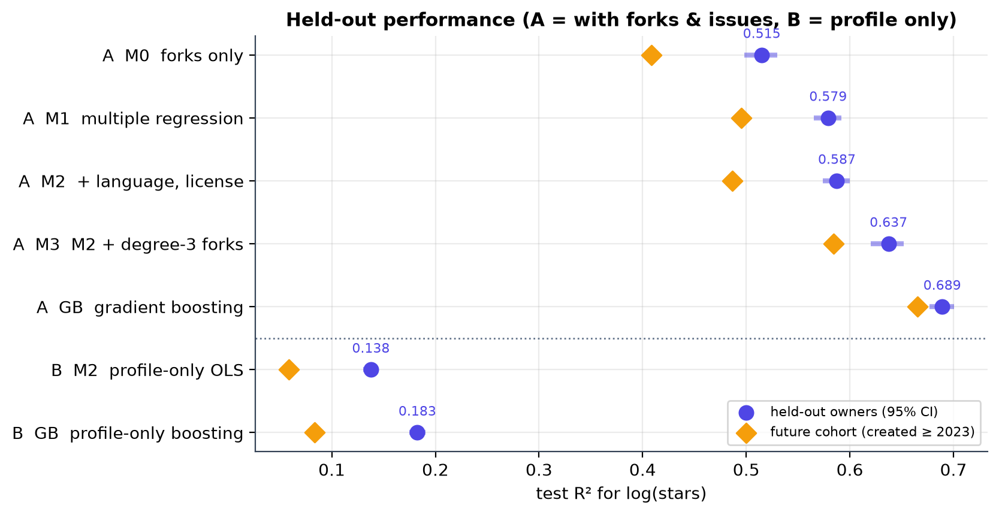
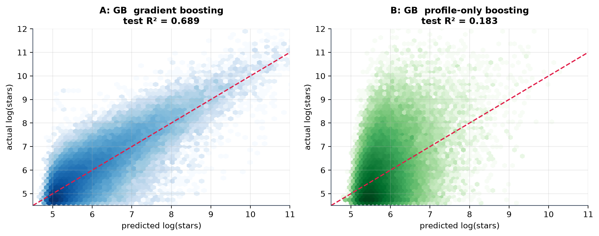
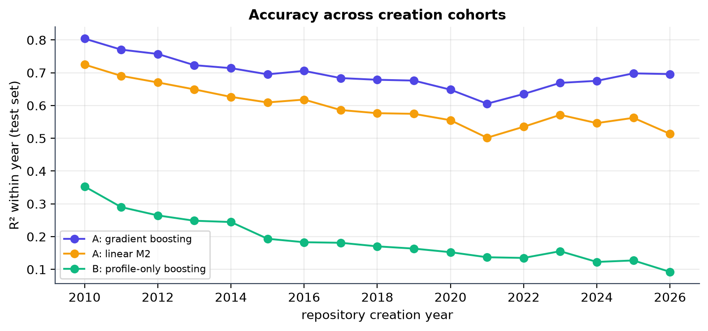
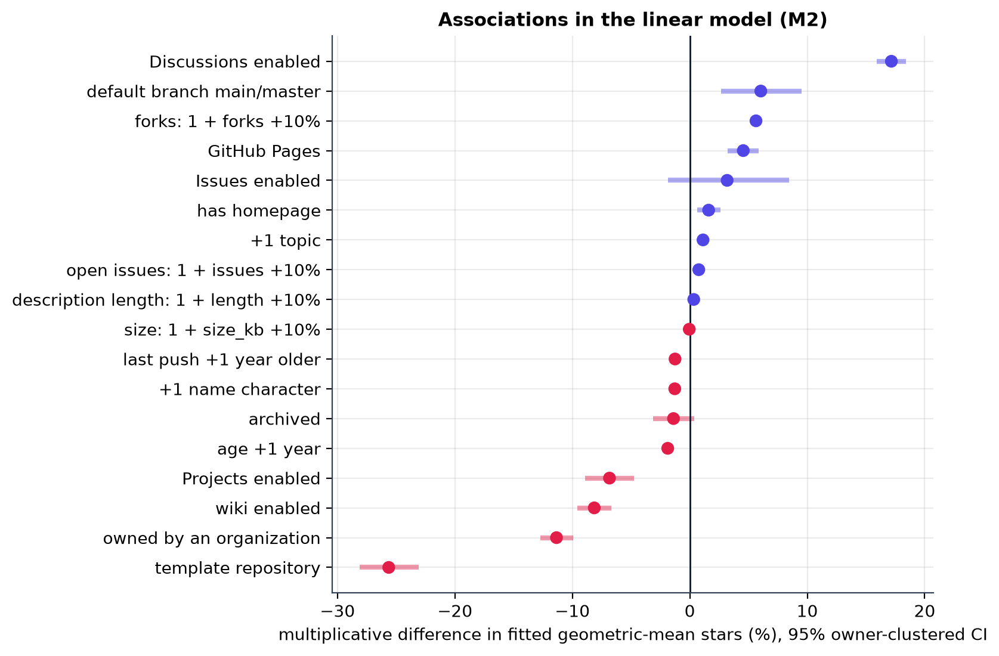

# What is associated with GitHub repository stars?

A data-science analysis of **483,348 public GitHub repositories with at least 100 stars** (search snapshot collected 2026-10-10): data collection with the GitHub API, feature engineering, regression diagnostics, and a leakage-aware model comparison.



## Headline result
Among repositories that already have 100+ stars, **forks alone explain about half of the variation in `log(stars)`** (test R² 0.515). Adding the other repository metadata, a non-linear forks term, or gradient boosting raises held-out R² to **0.689** (95 % CI 0.677–0.701; typical error ×1.56, 80 % of predictions within a factor of two). **Without forks and issues, profile metadata alone reach only R² 0.18.**

**Main limitation:** forks and open issues are measured in the same snapshot as stars, so this is a *cross-sectional association* study of a selected (≥100 stars) sample. It does not show that any feature *causes* stars and it does not predict a repository's success at creation.

## Results (all numbers come from `results/model_comparison.csv`)
Models are chosen on a validation set, refit on train + validation and scored once on a test set of **owners never seen in training**. The last column is a separate time holdout: everything (degree, boosting parameters, refit) uses only repositories created ≤ 2022, and the repositories created ≥ 2023 are scored once.

| Task | Model | Test R² (95 % CI, owner bootstrap) | RMSE (log scale) | Future cohort R² |
|---|---|---|---|---|
| A: association | M0 forks only | 0.515 (0.498–0.530) | 0.732 | 0.409 |
| A | M1 multiple regression | 0.579 (0.565–0.592) | 0.682 | 0.495 |
| A | M2 + language, license | 0.588 (0.574–0.600) | 0.675 | 0.487 |
| A | M3 M2 + cubic forks term | 0.637 (0.620–0.652) | 0.633 | 0.584 |
| A | Gradient boosting | **0.689** (0.677–0.701) | 0.586 | **0.665** |
| B: profile only | M2 without forks/issues | 0.138 (0.130–0.144) | 0.976 | 0.058 |
| B | Gradient boosting without forks/issues | 0.183 (0.175–0.190) | 0.951 | 0.084 |

Reading the table: the gain from forks is largely non-linear (M2 → M3 adds 0.05), boosting adds another 0.05, and the result holds up reasonably on newer repositories only for the models that use forks and issues. Profile-only models are weak and degrade on the newer cohort.

| | |
|---|---|
|  |  |

### Associations in the linear model (descriptive, not causal)
Multiplicative (percent) difference in fitted stars, other features held fixed. The model is fitted on log(stars), so these are differences in conditional geometric-mean stars, not in arithmetic expected star counts. Forks, open issues, size and description length enter as `log1p`, so their contrasts are for a 10 % increase in *1 + feature*. The 95 % intervals in `results/metrics.json` and the figure use **owner-clustered standard errors** (205,875 owner clusters), because repositories of one owner are not independent; they are about 1.9× wider than classical ones at the median (3.9× for forks). Two coefficients, *Issues enabled* and *archived*, have intervals that include zero:
- 1 + forks +10 % → **+5.6 %** fitted stars; 1 + open issues +10 % → +0.8 %
- Discussions enabled **+17 %**; template repository **−26 %**; organization-owned **−11 %**; wiki enabled −8 %
- Language vs Python: Rust +23 %, Go +15 %, Java −12 %. License vs MIT: no license −13 %

Because forks and issues are consequences of attention, these coefficients are "adjusted for popularity" and should not be read as advice (e.g. enabling Discussions is likely a *marker* of an already active community).



## How the evaluation avoids over-optimistic numbers
1. **Three-way split (60/20/20) grouped by owner**, so an owner's other repositories (e.g. ~1,900 from one organization) cannot leak into the test set.
2. **Language/license groups and the forks centring constant are learned from training rows only** (`src/stars_lib.py`, `FeaturePrep`; unit-tested).
3. **Polynomial degree and boosting hyper-parameters are chosen on validation data**; the test set is scored once, after refit on train + validation.
4. **Owner-clustered bootstrap** intervals instead of row-level ones.
5. **Time-based holdout** as a robustness check, with its own model selection made **inside the pre-2023 data** (train/validation split of those rows), so no 2023+ row influences any choice.

An earlier version of this notebook chose the polynomial degree on the test set and used a row-level split; its scores (0.591 / 0.646 / 0.699) were slightly optimistic compared with the ones above.

## Data
Collected with `collect_all.py` from the GitHub search API in 7-day creation windows (split further when a window exceeds the 1,000-result cap). Cache audit: no gaps, no missing pages, no truncated windows, no `incomplete_results` flags; GitHub's reported totals are one repository higher than the cache (483,350 vs 483,349). Details, caveats and the publication policy: [`docs/data.md`](docs/data.md).

The headline numbers come from one immutable input: `data/github_repos_all.csv` (collected 2026-10-10, 483,349 rows, 62 MB), pinned by the SHA-256 in [`data/SHA256SUMS`](data/SHA256SUMS) (`b842bc9d…a7b8`). It is meant to be distributed as a gzip asset of the GitHub Release `data-2026-10-10` (**not yet published**; see [`docs/data.md`](docs/data.md), so `python fetch_data.py` will not work until then) and is **not** committed (nor is the 243 MB raw API cache). A 20,000-row random sample is included so the code runs out of the box; its numbers differ from the table above.

## Reproduce
```bash
python -m venv .venv && source .venv/bin/activate
pip install -r requirements.txt

pytest -q tests                                   # unit tests (use the bundled sample)
python fetch_data.py                              # download the 2026-10-10 input and verify its SHA-256
python fetch_data.py --verify                     # re-check data/github_repos_all.csv at any time
jupyter nbconvert --to notebook --execute --inplace analysis.ipynb     # ~4 minutes on the full data
```
Without the fetch step the notebook falls back to the bundled sample. `results/metrics.json` records the SHA-256 of the file each run used (`data.source_sha256`); it must be `b842bc9d…a7b8` for the numbers in this README to apply. Recollecting from the API later produces a *different* snapshot and therefore different numbers.

To rebuild the data from scratch instead (needs the raw cache or a GitHub token):
```bash
export GITHUB_TOKEN=...                           # token with no scopes is enough
python collect_all.py                             # resumable; writes data/collection_report.json
python collect_all.py --rebuild-only              # CSV from cached pages, no network (byte-identical to the pinned file)
python audit_data.py                              # reconcile cache vs CSV; exits 1 on gaps, overlaps, truncation, ...
```

## Repository layout
```
analysis.ipynb        full analysis with outputs
src/stars_lib.py      loading, features, leakage-safe splits, models, metrics
collect_all.py        GitHub API collection + CSV build (failures logged, never silent)
fetch_data.py         download/verify (and pack) the pinned analysis input
audit_data.py         data-quality audit of the cache (fails on gaps, overlaps, truncation)
tests/                pytest suite (splits, leakage, collection failure handling)
figures/  results/    generated figures and the metrics quoted above
docs/                 data notes, audit output, LinkedIn draft
data/sample/          bundled 20k-row sample
```

## Limitations
- **Selected sample:** only repositories with ≥100 stars; coefficients describe association within that population, and `log(stars)` is truncated at `log(100)`.
- **Same-snapshot predictors** (forks, issues). Even the profile-only task uses post-hoc features such as `years_since_push`, so it is not a creation-time forecast.
- **Observational data:** no causal claims.
- **Snapshot:** GitHub search can lag; counts change daily.
- **Residual dependence** between repositories (forks, shared organizations or topics) is only partly handled: owner-grouped splits and owner-clustered intervals cover shared owners, not forks or topics.

## License
Code: MIT (see `LICENSE`). Data are public GitHub metadata subject to GitHub's terms; see `docs/data.md`.
